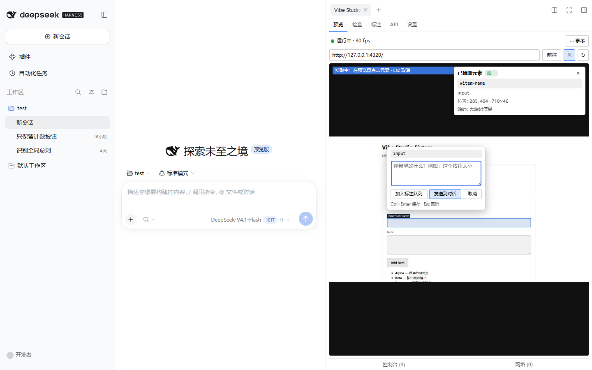
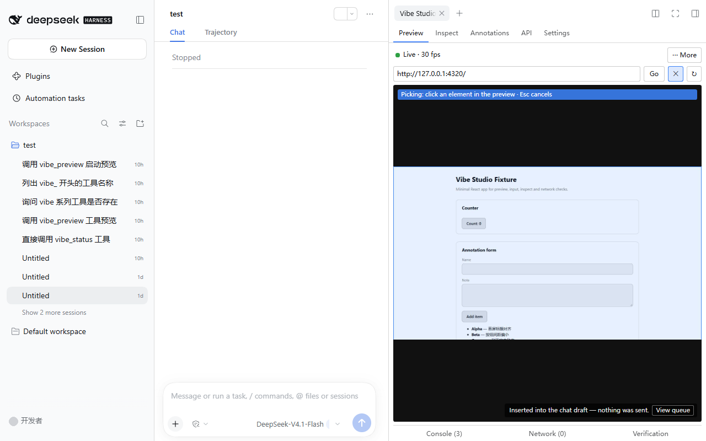
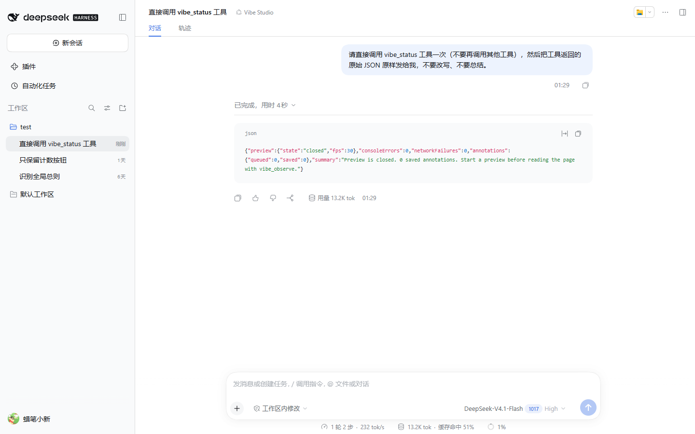
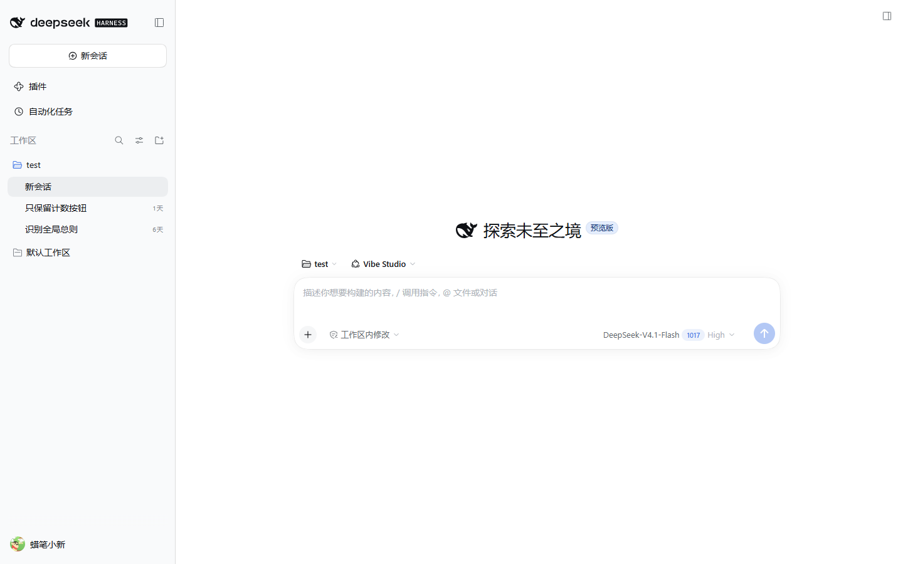
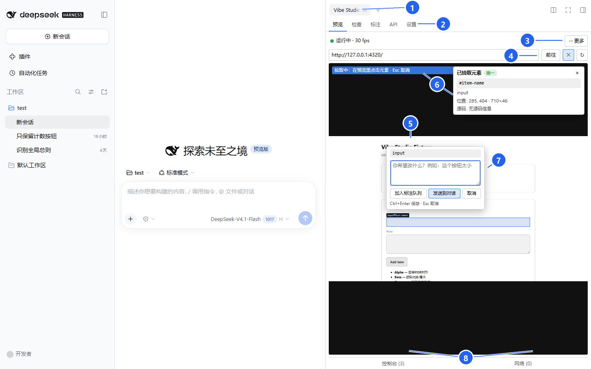
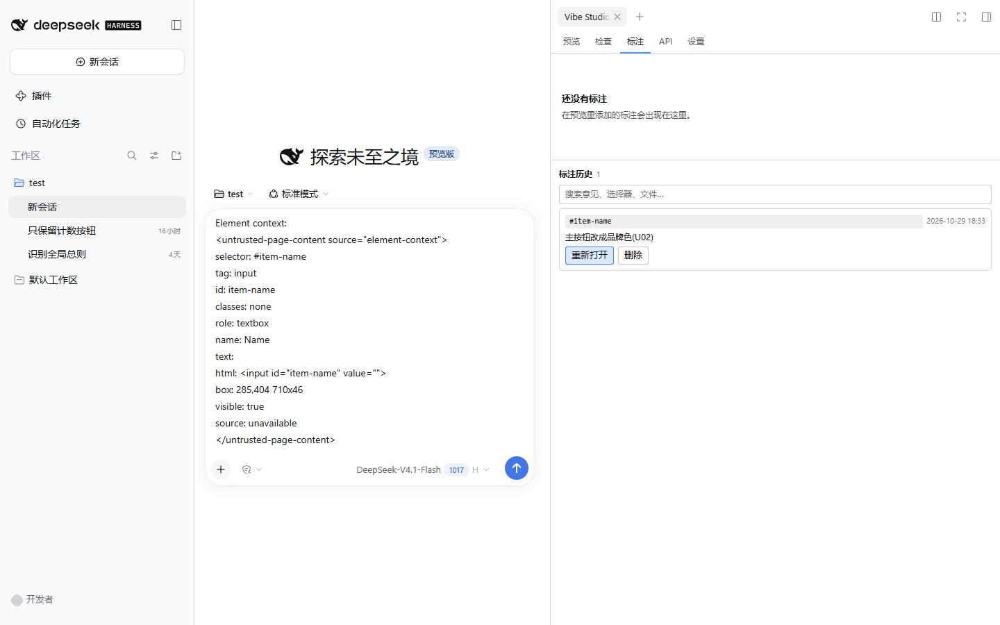
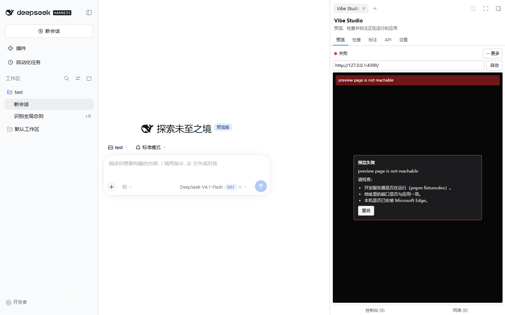

# Vibe Studio 使用说明（图文）

> 面向第一次使用 **DSH Vibecode Studio** 的开发者：用 5 分钟跑通
> **实时预览 → 点选页面元素 → 直接让 DSH 修改** 的闭环。
>
> 版本：`dsh-vibecode-studio@0.1.0`（pre-alpha）· 更新：2026-11-01
> 适用：Windows 11 + Microsoft Edge + DeepSeek Harness `0.2.1-rc.2` 或更新版本。
> 完整安装参数、配置项与边界见 [USER-GUIDE.md](./USER-GUIDE.md)；安全模型见 [SECURITY.md](./SECURITY.md)。

---

## 1. 最大特色：实时预览 + 点选元素，直接让 DSH 改

<p align="center">
  
</p>

<p align="center"><em>在 DSH 右栏预览本地应用，点中要改的元素，批注气泡就出现在元素旁边。</em></p>

传统做法是：截图 → 粘贴到对话 → 用文字描述“左边那个蓝色按钮”。截图会丢失元素身份、交互上下文和源码位置，Agent 只能猜。

Vibe Studio 把**预览本身变成反馈界面**：

1. **实时预览**：本地 Web 应用直接在 DSH 右栏运行，流式 JPEG 约 30 fps；页面可以点击、输入、滚动。
2. **点选元素**：点“检查”后，鼠标移到哪里，元素就高亮到哪里；点击后自动带出
   选择器、role / 可访问名称、DOM 片段、可见性和 **React / Vue / Svelte 开发态源码位置**。
3. **直接交给 DSH**：写下“这里要改成什么”，点「发送到对话」。批注进入当前会话的 composer 草稿，
   Agent 收到的是结构化上下文，而不是一张不透明的图片。

<p align="center">
  
</p>

<p align="center"><em>点「发送到对话」只是把结构化文本插入草稿，不会自动发送，也不会自动提交。</em></p>

Agent 实际收到的内容类似这样（来自真实标注）：

```text
Element context:
<untrusted-page-content source="element-context">
selector: #item-name
tag: input
id: item-name
role: textbox
name: Name
html: <input id="item-name" value="">
box: 285,404 710x46
visible: true
source: unavailable
</untrusted-page-content>

修改意见：主按钮改成品牌色，并补上 hover 态。
```

有了选择器和源码位置，Agent 可以直接定位到组件，而不是在整页里搜索文案。开启
`Vibe Studio` preset 后，它还能调用插件的四个工具补充上下文：

| 工具 | 作用 |
|---|---|
| `vibe_status` | 预览/标注/缓冲区状态与下一步建议 |
| `vibe_observe` | 读取页面 DOM、Console、Network 摘要（不可信包裹，≤ 8 KB） |
| `vibe_annotation_get` | 按 id 读取一条完整标注 |
| `vibe_preview` | reload / navigate / screenshot / start / stop；越权动作直接拒绝 |

<p align="center">
  
</p>

<p align="center"><em>Agent 调用 <code>vibe_status</code> 拿到的是宿主计数的结构化 JSON，而不是自然语言猜测。</em></p>

**改完之后的闭环**：Agent 修改文件后，预览状态行会出现「文件已改动」徽标；点刷新回到预览，
继续点选下一处。整个过程不会自动发送、自动批准或自动提交。

---

## 2. 5 分钟上手

### 2.1 前置条件

- Node.js 24、pnpm 11
- DeepSeek Harness `0.2.1-rc.2` 或更新版本
- 本机安装 Microsoft Edge（预览使用 `channel: 'msedge'`）
- 一个运行在 **localhost** 的 Web 应用（Vite / Next / 任意 dev server 均可）

> **只安装到开发 profile `vibe-dev`。** 不要安装到 `desktop` 或 `web`：它们是日常环境，
> 而本包仍是 pre-alpha。

### 2.2 安装插件

在仓库根目录：

```bash
pnpm install
pnpm build                                   # 产出 lib/index.js、lib/agent.js、lib/client.js
npm pack                                     # 产出 dsh-vibecode-studio-0.1.0.tgz

dsh plugin --profile vibe-dev add file:<仓库绝对路径>/dsh-vibecode-studio-0.1.0.tgz
```

开发时也可以直接链接源码（每次 `pnpm build` 后重启 DSH）：

```bash
dsh plugin --profile vibe-dev add link:<仓库绝对路径>
```

确认组合配置里出现 `vibe-studio` 与 `vibe-skill-bundled` 两行：

```bash
dsh --profile vibe-dev --dump-config
```

### 2.3 启动被测应用与 DSH

先在另一个终端启动要预览的应用。用本仓库自带的 demo fixture 最省事：

```bash
pnpm fixture:dev                             # http://127.0.0.1:4320
```

再启动 DSH：

```bash
dsh --profile vibe-dev --no-open --host 127.0.0.1 --port 4317
```

打开命令行打印的带 token 的 URL。**不要**用外部工具直接连接宿主端口。

### 2.4 打开 Vibe Studio

在 DSH 右栏点 **新标签页 → Vibe Studio**，在地址栏输入 `http://127.0.0.1:4320`
并回车。看到画面和绿色「运行中」状态即成功。

### 2.5 让 Agent 拿到 vibe 工具

在会话底部的模式菜单里选择 **Vibe Studio** preset（见下图）。standard 会话看不到这四个
`vibe_*` 工具；选择 preset 后，Agent 才能主动读取页面、标注和预览状态。

<p align="center">
  
</p>

<p align="center"><em>模式菜单中的 Vibe Studio preset；只影响当前会话。</em></p>

> 不选 preset 也能用：批注文本仍会插入草稿，但 Agent 没有 `vibe_*` 工具，
> 拿不到主动查询页面和标注的能力。

---

## 3. 功能导览

<p align="center">
  
</p>

<p align="center"><em>界面导览：编号对应下方说明（真实预览 + 点选批注状态）。</em></p>

| 编号 | 区域 | 作用 |
|---|---|---|
| ① | Studio 标签页 | 在 DSH 右栏打开/切换 Vibe Studio；关闭后从「新标签页」重开。 |
| ② | 五个页签 | 预览 / 检查 / 标注 / API / 设置；切换页签不会停止预览。 |
| ③ | 状态行 | 绿色「运行中」、实时帧率；「更多」里有在浏览器打开、刷新、重启、切换目标、适配面板。 |
| ④ | 地址栏 | 输入 localhost 地址后回车或点「前往」；右侧 X 停止、刷新按钮重载页面。 |
| ⑤ | 预览画布 | 本地应用的真实画面，可直接点击、输入、滚动；批注气泡覆盖在页面上。 |
| ⑥ | 拾取提示 + 元素卡片 | 蓝色提示条表示正在拾取；卡片显示选择器、标签、role/名称、位置与源码位置。 |
| ⑦ | 批注气泡 | 写修改意见；「加入标注队列」先攒批，「发送到对话」写入 composer 草稿，取消不改动。 |
| ⑧ | 底部抽屉 | 控制台 / 网络；覆盖式展开，开关不会重置预览（验证见 3.4）。 |

打开 Studio 后有五个页签：**预览 / 检查 / 标注 / API / 设置**。底部还有三个覆盖式抽屉：
**Console / Network / 验证**，开关抽屉不会重置预览。

| 能力 | 能做什么 | 入口 |
|---|---|---|
| 实时预览 | 在侧栏内嵌运行本地应用，点击、输入、滚动、切视口 | 预览 |
| 元素拾取 | 点选页面元素，自动提取选择器、DOM、可访问名称、源码位置 | 检查 |
| 批注队列 | 审核、编辑、发送到对话、历史重开与删除 | 标注 |
| 页面诊断 | Console、Network、一键四项只读验证 | 底部抽屉 |
| API 工作台 | 构建/发送请求、查看响应、环境与密钥、OpenAPI/cURL、抓包回放 | API |
| Agent 协作 | 四个 `vibe_*` 工具、`/vibe` 命令、内置技能 | 会话 |

### 3.1 预览

- 输入 `http://127.0.0.1:<端口>` 回车启动；默认只允许 loopback。
- 画面默认约 30 fps 流式 JPEG；断流时自动回退到拉取式 JPEG，恢复后切回。
- 页面内可直接点击、键入、滚动；中文输入走隐藏 textarea + composition 事件。
- 「更多」菜单：在浏览器打开、刷新、重启、切换目标、适配面板。
- **Console** 抽屉展示页面 console 与异常（上限 500 条）；**Network** 抽屉展示请求/响应
  （上限 300 条，4xx/5xx 标记，响应体按需加载）。
- **验证** 抽屉一键跑四项只读检查（预览目标、页面、Console、网络）；失败项可点击证据按钮
  跳到对应抽屉并高亮 2 秒。

### 3.2 检查（元素拾取）

1. 点「检查」页签里的拾取开关（或工具栏的拾取按钮）。
2. 移动鼠标，元素高亮；点击后弹出批注气泡。`Esc` 取消，`Alt+Click` 免模式拾取。
3. 气泡上方会带出元素卡片：唯一选择器、标签、role / 可访问名称、位置、源码位置。
4. 写下修改意见，`Ctrl+Enter` 保存，`Esc` 取消；空意见不会保存。

源码位置只在 React / Vue / Svelte 的**开发态**可用；取不到时显示“无源码信息”，
自动回退到选择器 + DOM 片段，仍然可用。

### 3.3 标注与历史

- 保存后进入「标注」页签的队列；每条可编辑、取消、发送或移除，页签带数量徽标。
- 保存通知里可直接点「发送到对话」，把结构化文本插入当前会话的 composer 草稿。
- **不会自动发送、不会自动提交**：文本进入草稿后，由你决定何时发送。
- 历史里的标注可搜索、重开入队、两步删除；落盘在 `.vibe/annotations/`，单文件、原子写入。

<p align="center">
  
</p>

<p align="center"><em>左侧 composer 中是 Agent 收到的结构化元素上下文；右侧是标注历史。</em></p>

### 3.4 验证

「验证」抽屉只做四项只读检查，不替代 Playwright 等测试工具：

- 预览目标是否可达、页面是否加载
- 页面是否有可见内容
- Console 是否有错误
- Network 是否有失败请求

失败项提供证据按钮，跳到 Console / Network 并高亮对应行。

### 3.5 API 工作台

默认是**新手模式**：首屏只有“方法 + URL + 发送”一行和常驻响应区。切到专业模式后，
额外出现 cURL 与结果校验。

- **发送**：query 参数、标头、JSON/文本/表单/multipart、三种身份验证；可取消，超时与重定向有稳定错误码。
- **响应**：状态与耗时、大小、content-type、重定向/截断徽标；JSON 折叠树、HTML 沙箱 iframe、
  图片预览、二进制下载；大响应按 64 KiB 分页。
- **更多工具**：收藏（集合）、历史、环境（`{{var}}` 与密钥引用）、OpenAPI 导入、cURL 导入/导出。
- **抓包回放**：在 Network 抽屉把一条请求转成草稿；非幂等方法先确认，**从不自动发送**。
- **结果校验**（专业模式）：状态码、响应头、JSONPath 子集、耗时四类断言。

密钥只存在 `ctx.credentials`，面板只读 `describe()`；导出、历史与模型上下文中的 URL/header/body
都经过脱敏。

### 3.6 设置

设置页写入 `.vibe/studio.json`，Host 读取同一份文档。可配置：

| 键 | 默认 | 含义 |
|---|---|---|
| `logLevel` | `info` | 宿主日志级别 |
| `allowedOrigins` | `http://localhost`、`http://127.0.0.1` | 预览可用的源 |
| `retentionDays` | `7` | 截图、抓包与日志保留天数 |
| `contextBudgetBytes` | `8192` | 交给模型的页面上下文上限 |
| `screenshotEnabled` | `true` | 是否允许截图进入 artifact store |

---

## 4. 完整示例：把 “Add item” 按钮改成品牌色

用本仓库的 fixture 演示：

```bash
pnpm fixture:dev                             # 终端 1：http://127.0.0.1:4320
dsh --profile vibe-dev --no-open --host 127.0.0.1 --port 4317   # 终端 2
```

1. 右栏打开 **Vibe Studio**，地址输入 `http://127.0.0.1:4320`，回车。
2. 会话模式选择 **Vibe Studio** preset。
3. 切到「检查」，打开拾取，点中 **Add item** 按钮。
4. 在气泡里写：`把按钮改成品牌色，并补上 hover 态`，`Ctrl+Enter` 保存。
5. 在保存通知里点「发送到对话」——批注进入 composer 草稿。
6. 检查草稿无误后按发送，让 Agent 修改代码。
7. Agent 改动文件后，预览状态行出现「文件已改动」；点刷新，确认按钮颜色和 hover。
8. 还有下一处问题？继续点选、写意见、发送。

> 截图只能“复制 PNG + 手动粘贴”：插件不会把截图作为附件自动发送给模型。
> 绝大多数界面问题用“选择器 + 源码位置 + 文字意见”就足够，必要时再附截图。

---

## 5. 和 Agent 协作的 5 个习惯

1. **先选 Vibe Studio preset**：Agent 才有 `vibe_status` / `vibe_observe` /
   `vibe_annotation_get` / `vibe_preview`。
2. **一条批注只说一件事**：选择器已经精确到元素，不要把多个问题塞进一条。
3. **写“期望结果”而不是“现状”**：例如“改成 16px 圆角、主色 #2563eb”，比“按钮不好看”有效。
4. **发送前先看草稿**：批注只进入 composer，发送权始终在你手里。
5. **改完先刷新再验证**：看到「文件已改动」徽标就刷新预览；用「验证」抽屉快速确认
   Console / Network 没有新错误。

斜杠命令 **`/vibe`** 可以快速查看一行状态和一条下一步建议；内置技能
**`vibecoding-studio`** 会在 Agent 需要时自动加载工作流说明。

---

## 6. 安全边界

- 预览目标默认只允许 **localhost**；非本地地址需要显式加入 `allowedOrigins` 并在提示时确认。
- 拒绝 `file:`、`chrome:`、`devtools:`、云元数据与私网地址。
- 不自动发送批注、不自动批准、不自动提交；截图不作为唯一证据。
- host/client 通信只走 `ctx.connection`，不直接使用 `ctx.webServer`。
- 页面内容按不可信处理；密钥只存放在 `ctx.credentials`，UI 只读 `describe` 元数据。
- CDP 只连接已启动或已批准的 loopback 端点，不暴露到网络，并清理进程树。
- 只安装到开发 profile `vibe-dev`；不修改 `desktop` / `web`。

已知限制与残余风险（截图过期无自动清理 F5、DNS rebinding F7、loopback 判定重复 F8 等）见
[SECURITY.md](./SECURITY.md) §5 与 [USER-GUIDE.md](./USER-GUIDE.md) §9。

---

## 7. 常见问题

| 现象 | 处理 |
|---|---|
| 右栏没有 Vibe Studio | 确认装的是 `vibe-dev`；`dsh --profile vibe-dev --dump-config` 查 `vibe-studio` 行；重启 DSH |
| Agent 看不到 `vibe_*` 工具 | 会话模式没有选 **Vibe Studio** preset；standard 会话不注册这些工具 |
| 预览报 `target_unavailable` | 本机没有 Edge，或目标端口没有监听 |
| 预览报 `port_in_use` | 目标端口被占用；换端口或先停掉占用进程 |
| 页面空白 / 帧率低 | 「更多 → 在浏览器打开」对照；确认是 loopback、未开代理；看 Console 是否有脚本错误 |
| 发送后 composer 没有文本 | 当前会话没有 composer（如全屏预览）；文本已回退到剪贴板，手动粘贴 |
| 状态行出现「文件已改动」 | Agent 改了源码；点刷新预览后再验证 |
| multipart 上传失败 | 一元通道 64 KiB 上限，实际单文件约 48 KiB |
| OpenAPI 导入报 `remote_ref_blocked` | 远程 `$ref` 默认拒绝；loopback 需显式许可，且不跟随 302 |

<p align="center">
  
</p>

<p align="center"><em>失败态会给出可执行的检查项和「重启」按钮，而不是只留一块黑屏。</em></p>

---

## 8. 更多文档

- [USER-GUIDE.md](./USER-GUIDE.md)：安装参数、配置、已知限制与排障
- [RELEASE.md](./RELEASE.md)：打包、干净安装验证与发布流程
- [SECURITY.md](./SECURITY.md)：安全模型、威胁清单与残余风险
- [SPEC-vibecoding-studio.md](./SPEC-vibecoding-studio.md)：产品与协议设计
- [DEVLOG.md](./DEVLOG.md)：开发记录与验证证据
- [2026-10-31-M6手动测试手册.md](./2026-10-31-M6手动测试手册.md)：M6 功能手测步骤

> 本文截图来自本仓库的 demo fixture（`pnpm fixture:dev`）与真实 `vibe-dev` profile；
> 中文 / 英文界面以实际版本为准。
